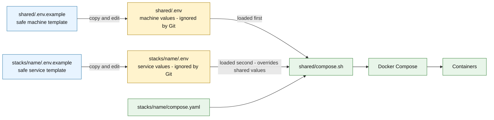
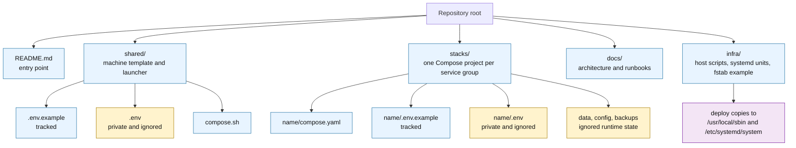
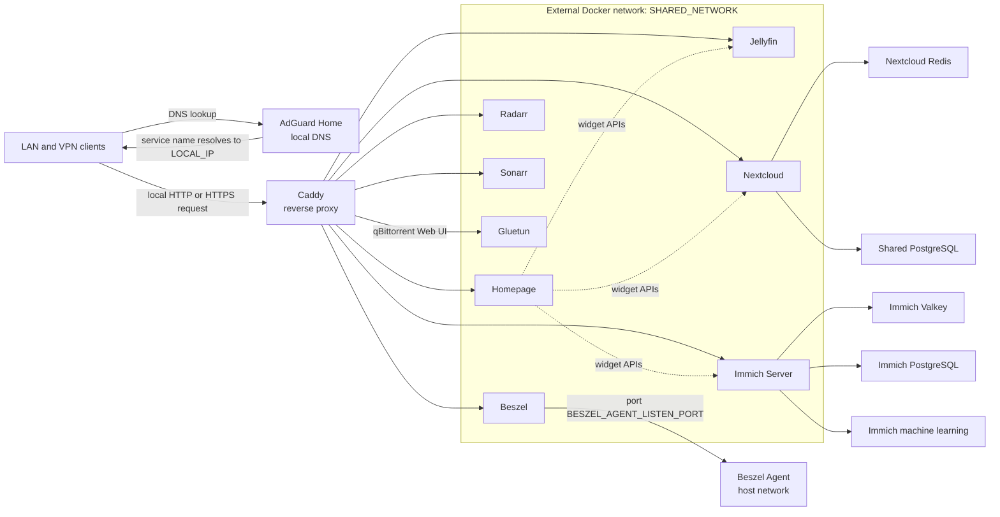
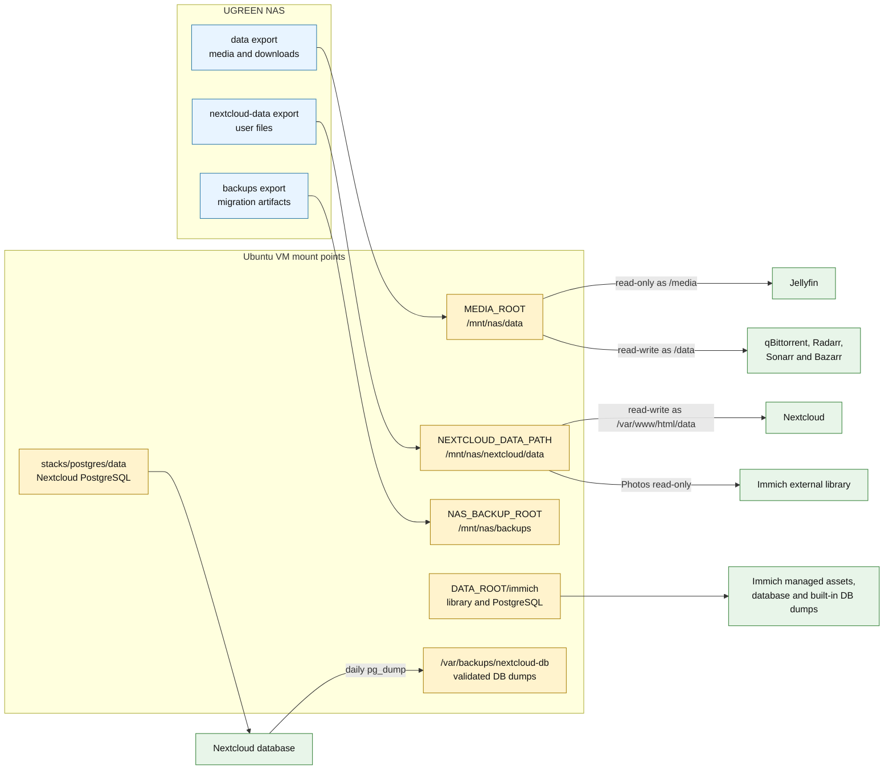
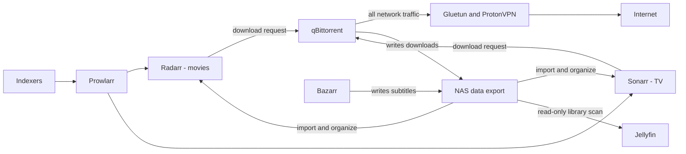
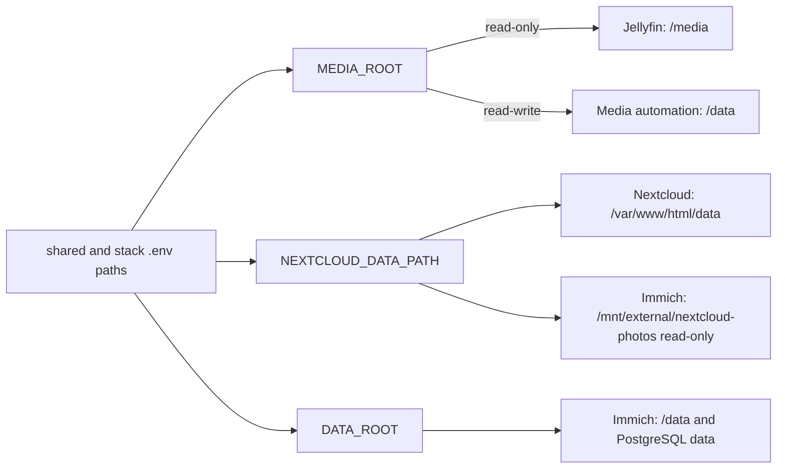

# Home Server Docker Stacks

This repository is a portable, Docker Compose-based home-server deployment.
Each application lives in its own stack under `stacks/`, while settings shared
by the whole machine live in `shared/`.

The repository currently provides:

- Local DNS and filtering with AdGuard Home
- Local reverse proxy routes with Caddy
- A Homepage dashboard
- Docker stack management with Dockge
- System monitoring with Beszel and Beszel Agent
- Media streaming with Jellyfin
- Photo management with Immich
- File sync and cloud storage with Nextcloud
- A shared PostgreSQL server
- A VPN-isolated torrent and media-automation stack

## How the repository works

Configuration is split into two levels:

1. `shared/.env` contains machine-wide settings such as the server IP,
   local domain, timezone, storage roots, Docker network name, user IDs, and
   host port allocations.
2. `stacks/<name>/.env` contains credentials and settings used only by that
   service.

Neither real `.env` file is committed. Safe `.env.example` templates document
every required variable.

All Compose commands should go through `shared/compose.sh`. The launcher loads
the shared environment first, then the selected stack environment:

```bash
./shared/compose.sh <stack-name> <docker-compose-arguments>
```

For example:

```bash
./shared/compose.sh homepage up -d
./shared/compose.sh homepage logs -f
./shared/compose.sh homepage down
```

Do not normally run plain `docker compose` inside a stack directory. Plain
Compose does not automatically load `shared/.env`.

### Configuration flow



Only `.env.example` files belong in Git. The actual `.env` files are private
deployment inputs. A value in a stack `.env` takes precedence over the same
name in `shared/.env`.

## Repository structure

```text
/opt
├── README.md                       # This guide
├── .gitignore                      # Excludes secrets and runtime data
├── docs/
│   ├── architecture/               # Storage topology and NAS integration
│   └── operations/                 # Backup, recovery, and troubleshooting
├── infra/
│   ├── examples/                   # Reproducible host config snippets
│   ├── scripts/                    # Mirrors of deployed host scripts
│   └── systemd/                    # Mirrors of deployed systemd units
├── shared/
│   ├── .env                        # Real machine-wide configuration; ignored
│   ├── .env.example                # Safe machine-wide configuration template
│   ├── compose.sh                  # Shared Compose command launcher
│   └── README.md                   # Short shared-config reference
└── stacks/
    ├── adguard/                    # DNS filtering
    ├── beszel/                     # Monitoring hub
    ├── beszel-agent/               # Host monitoring agent
    ├── caddy/                      # Local reverse proxy
    ├── dockge/                     # Compose stack management UI
    ├── homepage/                   # Service dashboard
    ├── immich/                     # Photo management
    ├── jellyfin/                   # Media streaming
    ├── nextcloud/                  # File sync and cloud storage
    ├── postgres/                   # Shared PostgreSQL server
    └── torrent/                    # VPN, torrents, and media automation
```



Directories such as `stacks/homeassistant`, `stacks/mqtt`, and
`stacks/watchtower` may exist locally, but they contain no tracked Compose
configuration and are not currently deployable services in this repository.

Other local paths may also appear below `/opt`:

| Path | Purpose |
|---|---|
| `backups/` | Local backup destination; ignored by Git |
| `containerd/` | Container runtime state; ignored and not part of the deployment definitions |
| `docs/` | Tracked architecture and operations documentation |
| `scripts/` | Optional location for host-level helper scripts |
| `passwords.txt` | Ignored local credential notes; not required by any Compose stack |
| `.agents/`, `.codex/` | Local development/assistant tooling, not homelab services |

## Architecture and operations guides

- [Storage architecture](docs/architecture/storage-architecture.md)
- [NAS integration and startup dependencies](docs/architecture/nas-integration.md)
- [Backup and restore](docs/operations/backup-and-restore.md)
- [Disaster recovery](docs/operations/disaster-recovery.md)
- [NAS troubleshooting](docs/operations/nas-troubleshooting.md)
- [Secret management](docs/operations/secret-management.md)
- [Host infrastructure deployment](infra/README.md)

The copies under `infra/` mirror required files deployed to `/usr/local/sbin`
and `/etc/systemd/system`. Editing the repository copies does not change the
live host; deploy them explicitly and keep both copies synchronized.

## Included services

| Stack | Containers | Purpose |
|---|---|---|
| `adguard` | AdGuard Home | DNS server, filtering, and local DNS management |
| `beszel` | Beszel | Central monitoring dashboard and metrics storage |
| `beszel-agent` | Beszel Agent | Collects metrics from this Docker host |
| `caddy` | Caddy | Routes local `*.LOCAL_DOMAIN` names to containers |
| `dockge` | Dockge | Web interface for managing Compose stacks |
| `homepage` | Homepage | Dashboard, links, Docker status, and service widgets |
| `immich` | Immich Server, machine learning, Valkey, PostgreSQL | Photo upload, indexing, search, and machine learning |
| `jellyfin` | Jellyfin | Media library and streaming server |
| `nextcloud` | Nextcloud, Redis | File storage, synchronization, and web access |
| `postgres` | PostgreSQL 17 | Shared database server, currently used by Nextcloud |
| `torrent` | Gluetun, qBittorrent, Radarr, Sonarr, Prowlarr, Bazarr, FlareSolverr | VPN-isolated downloading and media automation |

Immich uses its own PostgreSQL and Valkey containers. It does not use the
shared `postgres` stack.

## Network model

`SHARED_NETWORK` in `shared/.env` names an external Docker network used by
Caddy and the applications it proxies. Its default name is `home-server`.

The following stacks join that network:

- Beszel
- Caddy
- Homepage
- Immich
- Jellyfin
- Nextcloud and its Redis container
- Gluetun, Radarr, Sonarr, Prowlarr, and Bazarr

Nextcloud also reaches the shared PostgreSQL container through this network.
The current `postgres` Compose file does not declare `SHARED_NETWORK`; the
PostgreSQL container must therefore be connected manually after it is first
created or recreated. The first-time deployment steps include the command.

The torrent stack also has a private `torrent-backend` network for its internal
application traffic.

qBittorrent has no independent network interface. It uses
`network_mode: service:gluetun`, so its traffic passes through the VPN
container. Gluetun publishes the qBittorrent Web UI.

Beszel Agent uses host networking so the Beszel hub can reach its configured
listen port directly.

### Connectivity map



qBittorrent shares Gluetun's network namespace rather than joining a Docker
network directly. Its Caddy route therefore targets Gluetun's internal Web UI
port. Gluetun and qBittorrent are intentionally stopped while ProtonVPN is
inactive.

### Storage and data-source map



### Media automation pipeline



The VPN branch is intentionally inactive until subscription, tunnel, and
kill-switch behavior have been verified. Radarr, Sonarr, Prowlarr, Bazarr, and
Jellyfin can operate against existing NAS content without starting qBittorrent.

## Ports and local addresses

Host ports are allocated centrally in `shared/.env`.

| Service | Environment variable | Default host port | Notes |
|---|---|---:|---|
| AdGuard DNS | `ADGUARD_DNS_PORT` | `53/tcp`, `53/udp` | DNS clients should use the server's `LOCAL_IP` |
| AdGuard Web UI | `ADGUARD_WEB_PORT` | `8080` | Direct management interface |
| Beszel Agent | `BESZEL_AGENT_LISTEN_PORT` | `45876` | Host-network listen port |
| Beszel | `BESZEL_HOST_PORT` | `8090` | Also available through Caddy |
| Caddy HTTP/HTTPS | `CADDY_HTTP_PORT`, `CADDY_HTTPS_PORT` | `80`, `443` | Current routes use HTTP; port 443 is reserved/published |
| Dockge | `DOCKGE_HOST_PORT` | `5001` | Direct management interface |
| Homepage | `HOMEPAGE_HOST_PORT` | `3000` | Also available through Caddy |
| Immich | `IMMICH_HOST_PORT` | `2283` | Also available through Caddy |
| Jellyfin | `JELLYFIN_HOST_PORT` | `8096` | Also available through Caddy |
| Nextcloud | `NEXTCLOUD_HOST_PORT` | `8081` | Also available through Caddy |
| PostgreSQL | `POSTGRES_HOST_PORT` | `5432` | Protect with host firewall rules |
| qBittorrent | `QBITTORRENT_HOST_PORT` | `8091` | Bound to `LOCAL_IP`, routed through Gluetun |
| Radarr | `RADARR_HOST_PORT` | `7878` | Bound to `LOCAL_IP`, also available through Caddy |
| Sonarr | `SONARR_HOST_PORT` | `7879` | Bound to `LOCAL_IP`, also available through Caddy |
| Prowlarr | `PROWLARR_HOST_PORT` | `7880` | Bound to `LOCAL_IP` |
| Bazarr | `BAZARR_HOST_PORT` | `7881` | Bound to `LOCAL_IP` |

Caddy currently defines these local routes:

| Local URL | Upstream |
|---|---|
| `http://jellyfin.<LOCAL_DOMAIN>` | Jellyfin |
| `http://nextcloud.<LOCAL_DOMAIN>` | Nextcloud |
| `http://beszel.<LOCAL_DOMAIN>` | Beszel |
| `http://homepage.<LOCAL_DOMAIN>` | Homepage |
| `http://immich.<LOCAL_DOMAIN>` | Immich |
| `http://qbittorrent.<LOCAL_DOMAIN>` | qBittorrent through Gluetun |
| `http://radarr.<LOCAL_DOMAIN>` | Radarr |
| `http://sonarr.<LOCAL_DOMAIN>` | Sonarr |

For these names to work, DNS must resolve each name to `LOCAL_IP`. Configure
the records in AdGuard Home, another local DNS server, or client hosts files.

## Environment configuration reference

Start from the committed templates; never invent a real `.env` by copying
values from another installation:

```bash
cp shared/.env.example shared/.env
cp stacks/<stack>/.env.example stacks/<stack>/.env
chmod 600 shared/.env stacks/<stack>/.env
```

Use values appropriate to the new machine, NAS, network, users, ports, and
credentials. Text such as `<server-lan-ip>` below describes the required value
type; it is not a literal value to paste.

### Machine-wide values in `shared/.env`

| Variable | What to provide | Required? |
|---|---|---|
| `LOCAL_SCHEME` | `http` or `https`, matching how local service URLs are exposed | Yes |
| `LOCAL_IP` | Static/reserved LAN IP of the Docker host, such as `<server-lan-ip>` | Yes |
| `LOCAL_DOMAIN` | Local DNS suffix managed by AdGuard or another resolver | Yes |
| `LOCAL_HOSTNAME` | Hostname clients use for the Ubuntu VM | Yes |
| `TAILSCALE_IP` | This host's Tailscale IP; leave empty when Tailscale is unused | Optional |
| `PRIMARY_USER` | Ubuntu/Nextcloud username used when deriving user-specific paths and dashboard usernames | Yes |
| `PRIMARY_EMAIL` | Login email used by integrations such as the Beszel Homepage widget | When used |
| `PUID`, `PGID` | Numeric UID/GID that should own files written by LinuxServer.io containers | Yes for torrent apps |
| `TZ` | IANA timezone name, for example `<Region/City>` | Yes |
| `INSTALL_ROOT` | Absolute checkout parent; normally the directory containing this repository | Yes |
| `STACKS_ROOT` | Absolute stacks directory, normally derived from `INSTALL_ROOT` | Yes |
| `DATA_ROOT` | Mini-PC persistent-data root used by Immich and other local storage | Yes |
| `MEDIA_ROOT` | Mounted NAS media/download root; must not point to the legacy SMB mount | Yes |
| `SHARED_NETWORK` | Existing external Docker network shared by Caddy and applications | Yes |
| `NAS_HOST` | LAN IP or resolvable hostname of the NAS | Yes for reconstruction |
| `NAS_DATA_ROOT` | Ubuntu mount point for the NAS media/data export | Yes |
| `NAS_NEXTCLOUD_ROOT` | Ubuntu mount point for the Nextcloud export | Yes |
| `NAS_BACKUP_ROOT` | Ubuntu mount point for the NAS backup export | Yes |
| Host-port variables | An unused host port for every variable in the port table above | Yes for enabled services |

Set `NAS_HOST` to your NAS's address or hostname, then replace the current
homelab address (`192.168.0.220`) in **all three** NFS lines of
[`infra/examples/fstab.nas.example`](infra/examples/fstab.nas.example) before
merging them into your machine's `/etc/fstab`. If your export names or Ubuntu
mount points differ, update those lines and the matching `NAS_*_ROOT` and
`NEXTCLOUD_DATA_PATH` values too. `/etc/fstab` does not read or expand
`shared/.env`; changing `NAS_HOST` alone does not change the NFS mounts.
Verify the mounted sources with `findmnt` before starting NAS-dependent
containers.

### Stack-specific values

| Private file | Variables to configure | Guidance |
|---|---|---|
| `stacks/adguard/.env` | No service-only secret currently required | Keep the file because the launcher expects it; ports normally come from `shared/.env` |
| `stacks/beszel-agent/.env` | `BESZEL_AGENT_KEY`, `BESZEL_AGENT_TOKEN` | Generate both when adding the host in Beszel; do not reuse another agent's values |
| `stacks/beszel/.env` | No service-only value currently required | Beszel's host port normally comes from `shared/.env` |
| `stacks/caddy/.env` | No service-only value currently required | Domain, ports, and network come from shared configuration |
| `stacks/dockge/.env` | No service-only value currently required | Stack root and port come from shared configuration |
| `stacks/homepage/.env` | Widget API keys/passwords and `HOMEPAGE_VAR_BESZEL_SYSTEM_ID` | Supply only credentials for widgets enabled in `services.yaml`; obtain API keys from each application |
| `stacks/immich/.env` | `UPLOAD_LOCATION`, `DB_DATA_LOCATION`, `IMMICH_VERSION`, `DB_USERNAME`, `DB_PASSWORD`, `DB_DATABASE_NAME`, `NEXTCLOUD_DATA_PATH` | Use mini-PC paths for managed Immich data and the mounted NAS Nextcloud data root for the read-only external library |
| `stacks/jellyfin/.env` | `MEDIA_ROOT` plus optional shared overrides | `MEDIA_ROOT` must be the mounted NAS media root; Jellyfin receives it read-only as `/media` |
| `stacks/nextcloud/.env` | `POSTGRES_HOST`, `POSTGRES_DB`, `POSTGRES_USER`, `POSTGRES_PASSWORD`, `REDIS_PASSWORD`, `NEXTCLOUD_ADMIN_PASSWORD`, `NEXTCLOUD_DATA_PATH` | Database values must match the provisioned PostgreSQL role/database; the data path must be the mounted NAS Nextcloud data directory |
| `stacks/postgres/.env` | `POSTGRES_USER`, `POSTGRES_PASSWORD`, `POSTGRES_DB` | These bootstrap the shared PostgreSQL container; store the administrator password only in the private file |
| `stacks/torrent/.env` | `QBITTORRENT_INTERNAL_PORT`, `VPN_SERVER_COUNTRIES`, `WIREGUARD_PRIVATE_KEY`, `MEDIA_ROOT`, identity/network/host-port overrides | Leave `WIREGUARD_PRIVATE_KEY` empty and keep qBittorrent stopped until an active VPN and kill switch are verified |

<details>
<summary>Homepage widget variable checklist</summary>

| Variable | Obtain from |
|---|---|
| `HOMEPAGE_VAR_JELLYFIN_KEY` | Jellyfin API-key settings |
| `HOMEPAGE_VAR_IMMICH_KEY` | Immich API-key settings |
| `HOMEPAGE_VAR_QBITTORRENT_PASSWORD` | qBittorrent Web UI credentials |
| `HOMEPAGE_VAR_RADARR_KEY` | Radarr general/security settings |
| `HOMEPAGE_VAR_SONARR_KEY` | Sonarr general/security settings |
| `HOMEPAGE_VAR_PROWLARR_KEY` | Prowlarr general/security settings |
| `HOMEPAGE_VAR_BAZARR_KEY` | Bazarr general/security settings |
| `HOMEPAGE_VAR_NEXTCLOUD_PASSWORD` | Prefer a dedicated Nextcloud app password |
| `HOMEPAGE_VAR_BESZEL_PASSWORD` | Beszel account credentials |
| `HOMEPAGE_VAR_BESZEL_SYSTEM_ID` | The monitored system identifier shown by Beszel |
| `HOMEPAGE_VAR_ADGUARD_PASSWORD` | AdGuard Home account credentials |

Only populate variables for configured widgets. Prefer dedicated API keys or
app passwords over primary account passwords wherever the application
supports them.

</details>

Homepage's complete credential names are deliberately listed in
[`stacks/homepage/.env.example`](stacks/homepage/.env.example) and the
[secret-management guide](docs/operations/secret-management.md). Blank values
in an example usually indicate a secret that the operator must generate or
retrieve. Never copy an API key, password, token, private key, database dump,
or rendered Compose output into Git.

### Path derivation inside containers



Container paths are intentionally stable even when host paths differ between
installations. Change the host-side environment value, not the established
container path, unless the application is also reconfigured.

## Requirements

Install or provide:

- Linux with Docker Engine
- Docker Compose v2
- `nfs-common`, util-linux (`findmnt`), and coreutils for NAS integration
- A working `/dev/net/tun` device for Gluetun
- Reachability to the UGREEN NAS and its three NFS exports
- Storage paths configured by `DATA_ROOT`, `MEDIA_ROOT`,
  and `NEXTCLOUD_DATA_PATH`
- Correct ownership and permissions for the configured `PUID` and `PGID`
- A local DNS setup for the Caddy hostnames
- An active Proton VPN subscription and WireGuard key before starting Gluetun
  or qBittorrent

The repository is designed to live under `/opt`, but `shared/compose.sh`
detects its actual checkout location and overrides `INSTALL_ROOT` when it runs.
External storage locations are still controlled explicitly by `DATA_ROOT` and
`MEDIA_ROOT`.

## First-time deployment

### 1. Create the shared configuration

```bash
cd /opt
cp shared/.env.example shared/.env
chmod 600 shared/.env
```

Edit `shared/.env` and review every section:

- Machine identity: `LOCAL_IP`, `LOCAL_DOMAIN`, `LOCAL_HOSTNAME`, and
  `TAILSCALE_IP`
- Primary user: `PRIMARY_USER`, `PRIMARY_EMAIL`, `PUID`, and `PGID`
- Host defaults: `TZ`, installation and storage roots, and network name
- Host port allocation

`LOCAL_IP` must be the LAN address of the machine running Docker.

### 2. Create each stack's private configuration

Create the private environment file for every stack you plan to run:

```bash
for stack in \
  adguard beszel-agent beszel caddy dockge homepage \
  immich jellyfin nextcloud postgres torrent
do
  cp "stacks/$stack/.env.example" "stacks/$stack/.env"
  chmod 600 "stacks/$stack/.env"
done
```

Some stack files contain only comments because all of that stack's current
settings are machine-wide. Keep the file in place because the shared launcher
checks for it.

### 3. Enter service credentials

At minimum, review these stack environments:

| File | Required information |
|---|---|
| `stacks/beszel-agent/.env` | Agent SSH public key and token generated by Beszel |
| `stacks/homepage/.env` | Widget API keys, passwords, and Beszel system ID |
| `stacks/immich/.env` | Database name, user, password, version, and storage paths |
| `stacks/nextcloud/.env` | PostgreSQL and Redis credentials and admin password |
| `stacks/postgres/.env` | Shared PostgreSQL user, password, and database |
| `stacks/torrent/.env` | Proton WireGuard private key and server country |

Do not place real credentials in `.env.example`.

### 4. Create the external Docker network

Load the shared settings and create the network if it does not already exist:

```bash
set -a
. ./shared/.env
set +a

docker network inspect "$SHARED_NETWORK" >/dev/null 2>&1 ||
  docker network create "$SHARED_NETWORK"
```

### 5. Prepare storage

Follow [NAS integration](docs/architecture/nas-integration.md) to install the
NFS automounts and host units. Verify exact mount sources before starting any
NAS-dependent container.

Ensure these locations exist and are writable where required:

- `${DATA_ROOT}/immich/library`
- `${DATA_ROOT}/immich/postgres`
- `${MEDIA_ROOT}` (currently `/mnt/nas/data`)
- `${NEXTCLOUD_DATA_PATH}` (currently `/mnt/nas/nextcloud/data`)
- `${NEXTCLOUD_DATA_PATH}/${PRIMARY_USER}/files/Photos` for Immich's read-only
  external library

Immich mounts the existing Nextcloud photo directory read-only at:

```text
/mnt/external/nextcloud-photos
```

The host source must exist before starting Immich. Compose uses
`create_host_path: false` for migrated NAS mounts where applicable to avoid
silently creating local fallback directories.

Stack-local application data is created below each stack's `data/`,
`config/`, or `gluetun/` directory and is excluded from Git.

### 6. Prepare the shared Nextcloud database

Start PostgreSQL first:

```bash
./shared/compose.sh postgres up -d
```

Connect the PostgreSQL container to the shared network:

```bash
set -a
. ./shared/.env
set +a

docker network connect "$SHARED_NETWORK" postgres
```

Run the network-connect command after any PostgreSQL container recreation. If
Docker reports that the endpoint already exists, PostgreSQL is already
connected and no change is needed.

Nextcloud expects the database, role, and password named in
`stacks/nextcloud/.env`.

`stacks/postgres/initdb/01-init.sql` is currently empty. It is a placeholder
for initial SQL and does not create the Nextcloud role or database. Before a
fresh Nextcloud deployment, either:

- Add an appropriate initialization mechanism before PostgreSQL initializes
  an empty data directory, or
- Create the role and database manually after starting PostgreSQL.

PostgreSQL initialization scripts run only when its data directory is empty.
Do not commit a real database password in `01-init.sql`.

To open a PostgreSQL shell using the configured administrative user:

```bash
./shared/compose.sh postgres exec postgres \
  sh -c 'psql -U "$POSTGRES_USER"'
```

Create the Nextcloud role and database using the names and password from
`stacks/nextcloud/.env`. Enter secrets interactively; do not save them in
tracked documentation or templates.

### 7. Start the services

A sensible dependency order is:

```bash
for stack in \
  postgres adguard beszel beszel-agent immich jellyfin nextcloud \
  homepage caddy dockge
do
  ./shared/compose.sh "$stack" up -d
done

./shared/compose.sh torrent up -d \
  radarr sonarr prowlarr bazarr flaresolverr
```

Gluetun and qBittorrent are intentionally excluded while the ProtonVPN
subscription is inactive. Do not start either until the VPN connection and
kill-switch behavior have been verified.

## Everyday commands

### Start or reconcile a stack

```bash
./shared/compose.sh jellyfin up -d
```

`up -d` creates missing containers and recreates only containers whose
configuration changed.

### Stop and remove a stack's containers

```bash
./shared/compose.sh jellyfin down
```

Named volumes and bind-mounted data remain unless explicitly removed.

### Restart an unchanged container

```bash
./shared/compose.sh jellyfin restart
```

Use `up -d`, not `restart`, after changing Compose files or environment
variables. `restart` does not apply new Compose configuration.

### View status

```bash
./shared/compose.sh jellyfin ps
```

### Follow logs

```bash
./shared/compose.sh jellyfin logs -f
```

For one container in a multi-container stack:

```bash
./shared/compose.sh torrent logs -f gluetun
```

### Validate rendered configuration

```bash
./shared/compose.sh nextcloud config --quiet
```

To inspect the complete rendered model:

```bash
./shared/compose.sh nextcloud config
```

The rendered model can contain secrets. Do not paste or commit its output.

### Preview changes without applying them

```bash
./shared/compose.sh nextcloud --dry-run up -d
```

### Pull images and apply updates

```bash
./shared/compose.sh jellyfin pull
./shared/compose.sh jellyfin up -d
```

Images tagged `latest` or `release` are not updated until pulled.

### Stop all stacks

Stop dependent applications before their databases or infrastructure:

```bash
for stack in \
  dockge caddy homepage torrent nextcloud jellyfin immich \
  beszel-agent beszel adguard postgres
do
  ./shared/compose.sh "$stack" down
done
```

## Changing machine-wide settings

Edit `shared/.env` when changing:

- The server IP, hostname, or local domain
- Timezone or host user IDs
- Storage roots
- Shared Docker network name
- Any published host port

Then apply the affected stacks with `up -d`. For a broad shared change such as
`LOCAL_IP`, `LOCAL_DOMAIN`, or `SHARED_NETWORK`, reconcile every stack:

```bash
for stack in \
  adguard beszel-agent beszel caddy dockge homepage \
  immich jellyfin nextcloud postgres torrent
do
  ./shared/compose.sh "$stack" up -d
done
```

## Stack-specific notes

### AdGuard Home

- Publishes DNS on TCP and UDP port 53.
- Stores working data under `stacks/adguard/data/`.
- Local DNS rewrites can be used to resolve the Caddy hostnames.
- Changing the host's existing DNS listener may be necessary if port 53 is
  already occupied.

### Beszel and Beszel Agent

- Beszel is the central monitoring hub.
- Beszel Agent uses host networking and reads the Docker socket.
- Generate the agent key and token in Beszel, then place them in
  `stacks/beszel-agent/.env`.
- The hub URL is derived from `LOCAL_IP` and `BESZEL_HOST_PORT`.

### Caddy

- `stacks/caddy/Caddyfile` contains the local reverse-proxy routes.
- `LOCAL_DOMAIN` is expanded when Caddy parses the file.
- Upstreams use container names on `SHARED_NETWORK`.
- Current routes use HTTP site addresses. Publishing port 443 alone does not
  enable HTTPS.

### Dockge

- Has read/write access to the Docker socket.
- Mounts `STACKS_ROOT` so it can manage these Compose projects.
- Receives `COMPOSE_ENV_FILES`, allowing it to load `shared/.env` followed by
  each stack's `.env`.
- Recreate Dockge after changing its own Compose environment or mounts.

### Homepage

- Reads Docker state through a read-only socket mount.
- Service URLs and common usernames are derived from shared configuration.
- API keys and passwords stay in `stacks/homepage/.env`.
- `services.yaml` uses `{{HOMEPAGE_VAR_*}}` placeholders.

### Immich

- Runs its own database and Valkey containers.
- Stores its application library and PostgreSQL data on the mini PC under
  `/mnt/home-server-data/immich`.
- Mounts Nextcloud photos from the NAS read-only as an external library at
  `/mnt/external/nextcloud-photos`.
- Stores built-in database dumps in the application library's `backups/`
  directory; these are not independent of the mini-PC disk.
- Keep the Immich Compose file compatible with the chosen Immich release.

### Jellyfin

- Stores configuration and cache below `stacks/jellyfin/data/`.
- Mounts NAS-backed `MEDIA_ROOT` read-only at `/media`.
- Confirm the container can read the media files using the host's permissions.

### Nextcloud

- Uses the shared `postgres` stack and its own Redis container.
- Stores application files below `stacks/nextcloud/data/html/`.
- Stores user data on the NAS at `${NEXTCLOUD_DATA_PATH}` while preserving
  `/var/www/html/data` inside the container.
- Trusted domains are derived from the shared LAN IP, Tailscale IP, hostname,
  and local domain.

### PostgreSQL

- Provides a shared PostgreSQL 17 server.
- Persists data below `stacks/postgres/data/`.
- Exposes port 5432; restrict access using the host firewall.
- Files in `initdb/` execute only during first initialization of an empty data
  directory.

### Torrent and media automation

- Gluetun establishes the Proton VPN connection.
- qBittorrent shares Gluetun's network namespace.
- Gluetun and qBittorrent are intentionally stopped while ProtonVPN is
  inactive; qBittorrent's restart policy is `no`.
- qBittorrent's configuration and torrent state remain preserved under
  `stacks/torrent/config/qbittorrent/` and in the ignored pre-NAS migration
  archive.
- Radarr, Sonarr, Prowlarr, Bazarr, and FlareSolverr communicate over
  `torrent-backend`.
- Media applications mount `MEDIA_ROOT` at `/data`.
- `scripts/update-qbit-port.sh` receives Proton's forwarded port from Gluetun
  and applies it to qBittorrent through its local API.
- Gluetun must become healthy before qBittorrent starts.
- Never start qBittorrent until VPN egress and kill-switch behavior have been
  verified.

## File reference

### Repository files

| File | Purpose |
|---|---|
| `README.md` | Main installation and operations guide |
| `.gitignore` | Prevents secrets, runtime state, databases, logs, and backups from entering Git |
| `shared/.env.example` | Safe template for machine-wide configuration |
| `shared/.env` | Real machine-wide configuration; ignored and mode `600` |
| `shared/compose.sh` | Loads shared and stack environments before invoking Compose |
| `shared/README.md` | Concise shared-configuration reference |
| `infra/` | Reproducible mirrors of host scripts, systemd units, and NFS fstab lines |
| `docs/architecture/` | Storage and startup dependency design |
| `docs/operations/` | Backup, disaster recovery, and NAS troubleshooting runbooks |

### Files common to each stack

| File | Purpose |
|---|---|
| `compose.yaml` or `compose.yml` | Declares containers, images, ports, mounts, networks, healthchecks, and dependencies |
| `.env.example` | Safe template for that stack's service-only variables |
| `.env` | Real service-only values; ignored and mode `600` |
| `data/`, `config/`, or similar runtime directories | Persistent application state; ignored by Git |

### Unique stack files

| File | Purpose |
|---|---|
| `stacks/caddy/Caddyfile` | Local hostnames and reverse-proxy upstreams |
| `stacks/homepage/config/bookmarks.yaml` | Dashboard bookmark groups |
| `stacks/homepage/config/services.yaml` | Service cards, links, and API-backed widgets |
| `stacks/homepage/config/settings.yaml` | Dashboard title, theme, language, and layout settings |
| `stacks/homepage/config/widgets.yaml` | Resource, date/time, and search widgets |
| `stacks/homepage/config/docker.yaml` | Homepage Docker socket integration |
| `stacks/homepage/config/kubernetes.yaml` | Placeholder for Kubernetes integration |
| `stacks/homepage/config/proxmox.yaml` | Commented example for Proxmox integration |
| `stacks/homepage/config/custom.css` | Optional custom dashboard styles |
| `stacks/homepage/config/custom.js` | Optional custom dashboard JavaScript |
| `stacks/postgres/initdb/01-init.sql` | Placeholder for first-initialization SQL |
| `stacks/torrent/scripts/update-qbit-port.sh` | Synchronizes Proton's forwarded port into qBittorrent |

## Persistent data and backups

Git stores deployment definitions, not application data.

See [Backup and restore](docs/operations/backup-and-restore.md) for the verified
timer schedule, retention, artifact locations, snapshot settings, migration
archives, restore outline, and current coverage gaps.

Back up at least:

- `shared/.env`
- Every `stacks/<name>/.env`
- Stack-local `data/`, `config/`, and `gluetun/` directories
- `DATA_ROOT`
- `MEDIA_ROOT` where the media itself must be protected
- `/mnt/nas/nextcloud/data`
- `/mnt/nas/backups` where retained NAS-hosted artifacts are required
- PostgreSQL and Immich database data using application-consistent backup
  procedures

Copying only this Git repository to another machine does not copy databases,
photos, media, credentials, or application state.

The NAS currently has one physical disk. Its Btrfs snapshots are not an
independent backup. Important data needs an external/offsite copy.

Before backing up a live database directory at the filesystem level, stop the
database or use its supported logical backup tools.

## Git and secret safety

The root `.gitignore` excludes:

- Real `.env` files
- Password, credential, key, certificate, and VPN files
- Application runtime data and databases
- Logs, archives, backups, and temporary files
- Torrent application configuration and Gluetun state
- Container runtime state

Safe `.env.example` files are explicitly allowed.

Before committing:

```bash
git status
git diff --cached --check
```

Never use `git add -f` on a real `.env`, credential file, application data
directory, or database.

## Moving to another machine

For a transplant:

1. Copy or clone this repository.
2. Copy the private `.env` files securely, or recreate them from the examples.
3. Edit `shared/.env` for the new IP, hostname, domain, user IDs, storage
   roots, network name, and port availability.
4. Transfer the required persistent data separately.
5. Deploy the `infra/` host files, reconstruct NFS automounts, and verify exact
   mount sources.
6. Create the external Docker network and verify storage ownership and
   `/dev/net/tun`.
7. Validate every selected stack with `shared/compose.sh <stack> config`.
8. Start PostgreSQL, attach it to `SHARED_NETWORK`, and provision Nextcloud's
   role and database.
9. Start Nextcloud and the remaining stacks in dependency order.
10. Configure local DNS to point the new local names at the new `LOCAL_IP`.

Use the full [disaster recovery runbook](docs/operations/disaster-recovery.md)
for an actual rebuild.

## Troubleshooting

### Compose reports an unset variable

Use the shared launcher:

```bash
./shared/compose.sh <stack> config
```

Confirm both `shared/.env` and `stacks/<stack>/.env` exist.

### A local hostname does not resolve

Confirm:

- The name uses the configured `LOCAL_DOMAIN`
- DNS points the name to `LOCAL_IP`
- Caddy is running
- The target container is attached to `SHARED_NETWORK`

### Caddy returns a 502 response

The upstream application may be stopped, unhealthy, or absent from the shared
network:

```bash
./shared/compose.sh caddy logs
./shared/compose.sh <upstream-stack> ps
```

### Nextcloud cannot connect to PostgreSQL

Confirm:

- The `postgres` stack is running
- Both stacks use the same `SHARED_NETWORK`
- The Nextcloud role and database exist
- The credentials in `stacks/nextcloud/.env` match the provisioned role

### Torrent services cannot reach the Internet

Check Gluetun first:

```bash
./shared/compose.sh torrent ps
./shared/compose.sh torrent logs -f gluetun
```

Confirm `/dev/net/tun`, the WireGuard key, and the configured VPN server country.

### A configuration change did not take effect

Reconcile the stack:

```bash
./shared/compose.sh <stack> up -d
```

Do not rely on `restart` after changing Compose or environment files.
